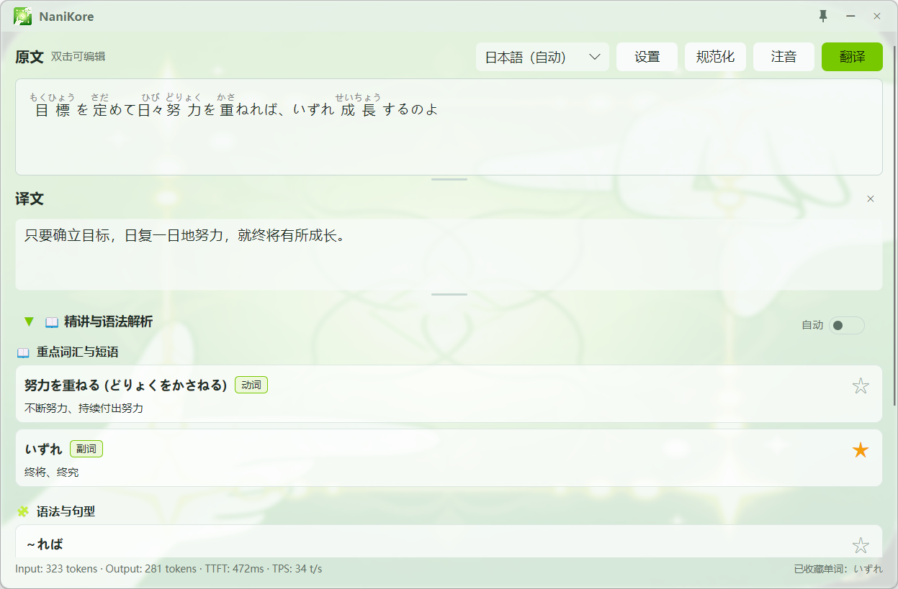
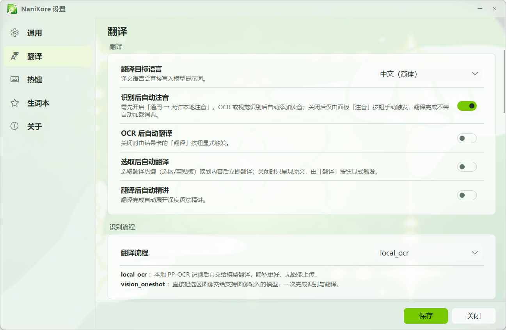

<div align="center">
  
  <h2>NaniKore（这啥玩意）</h2>
  本地优先的 OCR + 翻译、语言学习工具
  <br/>
  框选屏幕/划选/剪贴板取词·离线文字识别注音·自备 LLM 接口翻译/精讲（BYOK）
</div>

<p align="center">
  
  
  
  
  <!--  -->
</p>

## 界面一览
<div align="center">
  
  <p>结果面板：NaniKore 借助 PP-OCRv6-small 识别选中文字，并提供简体中文拼音、日语振假名、英语 IPA三语注音功能，支持将单词收藏到本地数据库</p>
  <br/>
  
  <p>设置面板-翻译页：翻译与精讲由配置的模型提供，同样可以通过llama.cpp/ollama/vllm/sglang等方案本地自部署，完全离线使用</p>
</div>

## 三步开始

### 1 下载
从 [GitHub Releases](https://github.com/Stareven233/NaniKore/releases) 下载压缩包

| 包 | 用途 | 依赖下载 |
| --- | --- | --- |
| `NaniKore-v{版本}-win_amd64.zip` | 按需下载依赖 | OCR 及注音数据按需下载 |
| `NaniKore-v{版本}-win_amd64-full.zip` | 无网络环境或希望开箱即用本地 OCR/注音 | 自带 OCR 与注音语言包 |
| `NaniKore-v{版本}-win_amd64-patch.zip` | 更新已有安装目录 | 仅覆盖程序文件，不含依赖，不能单独启动 |

推荐轻量包（`NaniKore-v*-win_amd64.zip`），尤其是仅通过vlm直接翻译截图的场景。翻译功能需在“设置 → 翻译”配置模型及 API Key。API Key 由当前 Windows 用户的 DPAPI 加密后保存在应用目录的 `.data/keys.bin`

### 2 配置
1. 若使用OCR、注音需要先到设置-通用页下载依赖
2. 到设置-翻译页配置模型并填写 api key。零门槛快速体验可以直接用B站的Index-Translate，已填好预设，随便输入英文数字字符串作为key即可试用

### 3 识别
按下快捷键 `Ctrl+Shift+A` 并通过鼠标框选文字区域进行识别、翻译

## 功能

- 全局截图热键 `Ctrl+Shift+A`：拖动鼠标框选并识别屏幕文字，框选过程中按 `Esc` 或鼠标右键取消
- 全局选取/剪贴板热键 `Alt+A`：优先读取选中文本，其次剪贴板文本或图像；识别到的文本默认由用户手动触发翻译
- 本地注音：目前支持日语振假名、英语国际音标（IPA）、简体中文拼音
- 可选模型服务：支持 OpenAI、Claude、Gemini 兼容协议的流式翻译配置，以及 本地ocr（`local_ocr`） 和 视觉语言模型处理截图（`vision_oneshot`） 两种输入方式
- 翻译结果支持精讲与划词收藏，保存在本地 SQLite 数据库，可筛选和编辑

## 系统要求

- 目前仅在 Windows 10/11 上测试，理论上应当也能编译到linux
- 应用以 Native AOT 发布，不需要 .NET Runtime

## 数据、备份与升级

配置、密钥密文和收藏数据库均位于应用目录下的 `.data/`，不包含在发行 ZIP 中，仅需保存该文件夹即可实现备份，配置或密钥读取失败，应用会提示并拒绝覆盖无法读取的原文件

但是 `.data/keys.bin` 依赖当前 Windows 用户的 DPAPI 保护，复制到另一 Windows 用户或另一台机器后，密钥通常无法解密，不过也只需要在新环境中重新填写 API Key，配置本身不会丢失

## 从源码构建

需要 .NET 11 SDK（`global.json` 要求 `11.0.100`，并允许同一通道更新的 feature band）、Git 和 Windows x64 Native AOT C++ 构建工具链（Visual Studio 2022 或 Build Tools，安装“使用 C++ 的桌面开发”工作负载及 Windows SDK）

运行release发布的压缩包不需要上述开发工具

```powershell
# Debug 构建
./scripts/dev.ps1 build

# Native AOT Release 构建
./scripts/dev.ps1 build -Release

# 无 UI 自动化自测
./scripts/dev.ps1 test

# 生成轻量包、完整离线包或已有安装用补丁包
./scripts/dev.ps1 publish
./scripts/dev.ps1 publish -full
./scripts/dev.ps1 publish -patch
```

## 性能

以下为v1.0.0版本 Native AOT Release 实测，仅供参考

| 指标 | 中文样例 | 英文样例 |
| --- | ---: | ---: |
| 输入图片 / 检出行数 | 186 × 91 / 4 行 | 325 × 60 / 11 行 |
| 新进程至首次 OCR 结果，中位数（每组 7 次） | 1.27 s | 2.56 s |
| OCR 核心耗时，中位数（每组 7 次） | 817 ms | 2.11 s |
| 新进程 OCR 峰值工作集，中位数 | 193 MiB | 418 MiB |
| 新进程 OCR 峰值私有内存，中位数 | 182 MiB | 423 MiB |
| 已加载模型后的热识别 OCR 核心耗时，中位数（每种 22 次） | 877 ms | 2.27 s |
| 热识别后工作集 / 私有内存，中位数 | 131 / 96 MiB | 191 / 158 MiB |

**应用启动与常驻内存：** 从启动发布版进程到应用输出初始化完成标记，中位数 **3.30 s**（5 次；OCR 模型按需加载，不包含模型加载）。应用空闲 3 秒后工作集约 **50.7 MiB**、私有内存约 **24.3 MiB**。首次模型加载及 OCR 期间，以 5 ms 间隔采样到的峰值中位数为工作集 **508 MiB**、私有内存 **480 MiB**（两轮完整应用测试）

**环境与口径：** Windows 10 22H2（build 19045）x64，Intel Core i5-8300H，15.8 GiB 内存，机械硬盘 + ONNX Runtime CPU，PP-OCRv6-small

两张样例图尺寸和识别行数不同，文字越多识别开销越大：PP-OCRv6 是一个检测 + 识别的两阶段流水线，det 模型负责定位每一行文字的位置，rec 模型则逐行识别（总耗时和内存占用随行数增加）

## 已知限制

- 多屏、负坐标虚拟桌面与混合 DPI 已有实现，但莫得多显示器测
- OCR 结果会受文字尺寸、对比度、背景和裁剪范围影响，毕竟只是个跑在cpu上的small模型，不过总体准确度还是够用的

## 致谢
- [LinuxDo](https://linux.do/): 佬友个个都是人才，说话又好听，还有赛博鸡蛋领
- [Index-Translate](https://index-translate.bilibili.com/): b站开源的翻译模型，支持文本/图片输入，又快又好，甚至还有免费api！

## 许可证与第三方声明

- NaniKore 自身代码依据 [GNU GPL-3.0-or-later](LICENSE) 授权
- 第三方程序、OCR 模型及注音数据的许可、归属和再分发说明见 [NOTICE](NOTICE)
