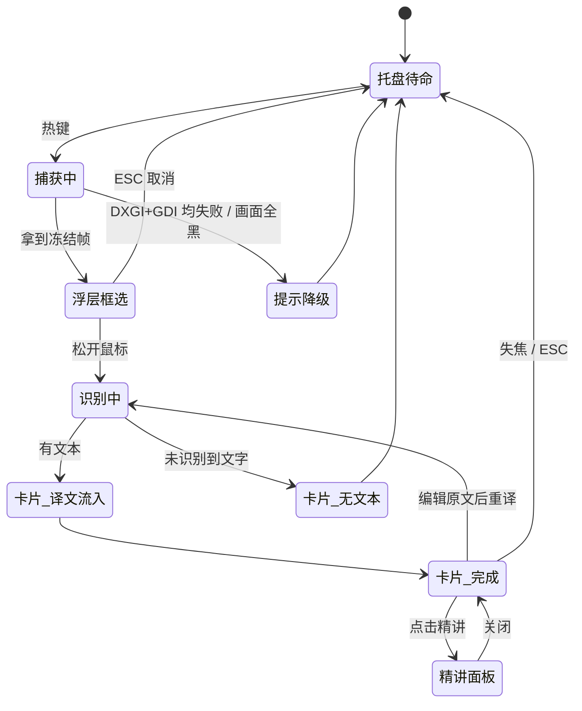

# v1 端到端穿刺：从热键到译文

## 这个 Epic 要改变什么

项目当前没有任何代码，`codestable/spec/index.md` 为空。本 epic 从零建立一条**最薄但完整**的链路：按下热键 → 冻结画面 → 框选 → OCR → 阅读顺序重建 → 流式翻译 → 结果卡片 → 按需精讲。

它同时是 NaniKore 五个能力区域（捕获 / 选区 / 识别 / 理解 / 呈现与常驻）的第一次建设。但目标**不是**把五个区域各自做完，而是每个区域只做到"链路能通且风险已证伪"的程度。

## 为什么现在做

技术风险集中在一个地方，而且是可能推翻整个技术栈的地方：**Gio 里手写的全屏框选浮层，在多屏混合 DPI 下能不能拿到正确的物理像素矩形**。这件事没有 Go 库现成可用（子 agent 调研确认无一个 Go 项目做过区域选择），必须自己写；写不出来就得换 C#/WPF 或 Rust。

在这个问题有答案之前，讨论翻译模型、精讲 prompt、结果面板排版都是在给可能不存在的地基装修。所以第一刀必须切浮层，且必须一路打通到译文——只有真的看到译文出现，才知道中间每一段的假设都成立。

## 来源 Vision

- `codestable/vision/index.md`：摘取主旅程（看不懂屏幕上的一段文字）与全部五个能力区域的最小可用部分，加上"译文看懂了但想知道为什么"和"OCR 认错了一个词"两条旅程。
- 不在本次边界内的相邻愿景：连续翻译 / 实时字幕、本地 ONNX 内嵌、Windows.Media.OCR 兜底、生词本、竖排文本、译文原位覆盖。这些留在 Vision 的「探索空间」，本 epic 不碰。

## 关联 Project Spec

- `codestable/spec/index.md`：当前为空。本 epic 关闭时首次写入项目真相——五个能力区域各自的实际行为、provider 契约、已验证的平台边界。

## 当前方案

五个区域按数据流串成一条单向管道，每一段的产物都是下一段的唯一输入。这样任意一段都能单独替换或单独测试。

```text
热键          捕获              选区            识别                 理解           呈现
[hotkey] → [frozen frame] → [rect(px)] → [text + reading order] → [stream] → [card / panel]
             DXGI 主                        leaf-ocr /ocr          OpenAI 兼容
             GDI 兜底                       + 自研重排             流式
```

**捕获**用 DXGI（`kirides/go-d3d`）为主路径，GDI（`kbinani/screenshot`）为兜底。这个主次顺序由用户主场景决定：游戏和视频是硬件加速内容，GDI 的 `BitBlt` 在那里必黑。反过来 DXGI 也有失效场景（RDP、Win11 竖屏显示器、部分虚拟机），所以两条路都要有，且失败要能自动降级。

**选区**用 Gio 开无边框全屏窗口，显示已冻结的位图，外围压暗、拖框、放大镜、ESC 取消。关键点是这里不需要窗口透明——显示的是自己截来的图，所以绕开了 WebView2 那类透明窗口的老问题。

**识别**调 leaf-ocr 已有的 `/ocr` 拿到行级片段，然后做阅读顺序重建。重建是 NaniKore 自己的逻辑，不在 OCR 服务那边加。

**理解**用一个 OpenAI 兼容的流式客户端，翻译与精讲是两个 provider 槽位，v1 指向同一个配置。语言方向交给模型按指令判断，客户端不检测。

**呈现**分两层：选区下方的小浮卡装译文（不抢焦点），点"精讲"才展开大面板。

## 需求变化

相对空白的 project spec，本 epic 建立起：

- 五个能力区域的存在与职责划分，以及它们之间的四个数据契约（frame / rect / text / stream）。
- provider 抽象：OCR、翻译、精讲三个可替换端点，云端与本机只是配置差异。
- 已验证的平台边界：独占全屏与 DRM 内容的行为、多屏混合 DPI 的坐标规则、DXGI 与 GDI 各自的失效场景。
- 术语：Vision 的「统一语言」在实现中被证实或修正后合并进 project spec。

## 界面与交互变化

图示状态：**目标**。布局与文案参照 `codestable/vision/index.md` 的「目标体验与界面」，此处只补充 v1 的状态迁移与降级路径。

### 目标流程与状态

- 角色与入口：单用户，托盘常驻，全局热键触发。
- 图示状态：目标



- 交互与关键状态：拖框过程中选区尺寸与放大镜始终可见；译文与精讲均流式填充，首字尽早出现；结果卡片全程不抢焦点。
- 稳定约束：浮层显示的是冻结位图而非实时画面；ESC 在浮层和卡片两处都能退出；原文可编辑并触发重译。
- 仅作示意：卡片与面板的具体尺寸、圆角、配色、动画。

### 降级提示的三种情形

需要区分给出不同文案，因为用户的下一步动作不同：

| 情形 | 判据 | 用户该做什么 |
|---|---|---|
| 独占全屏游戏 | DXGI `ACCESS_LOST` 持续 / 捕获结果全黑且前台为全屏进程 | 把游戏切到无边框窗口模式 |
| DRM 保护内容 | 捕获结果全黑，前台为播放器 / 浏览器 | 无解，说明该内容受保护 |
| OCR / LLM 端点不可用 | 连接失败或超时 | 检查 leaf-ocr 是否在跑 / 检查 API Key 与网络 |

## 架构考量

**为什么单向管道而不是事件总线。** 五段之间没有回环（编辑原文重译是从第四段重新进入，不是反向调用），单向管道足够且更容易测试每一段。加总线是在为不存在的多对多通信付抽象成本。

**为什么 OCR 保持在进程外。** 用户已有 leaf-ocr 在本机运行，先连它是最快的端到端验证路径。更重要的是这迫使 OCR 从第一天就是一个 provider 接口而不是内联调用——将来无论换成内嵌 leaf-ocr 离线包、Go 直接跑 ONNX，还是 Windows.Media.OCR 兜底，改的都只是实现。

**为什么翻译和精讲是两个槽而不是一个。** Hy-MT2 是在翻译数据上专门微调的模型，这类模型的通用指令跟随能力通常被牺牲，它能否做精讲**未经验证**。v1 让两个槽指向同一个云端 provider，几乎不花成本；但接口分开之后，将来接本地 Hy-MT2 时可以只让它填翻译槽。反过来如果一开始合成一个，事后要拆就得动数据流。

**为什么精讲输出 Markdown 而不是 JSON。** 词条卡片看起来需要结构化输出，但流式 JSON 解析在模型跑偏时会让整个面板空白；Markdown 边流边渲染，最坏情况只是排版丑。这是拿"结构精确"换"永远有东西可看"。

**为什么捕获要先冻帧再显示浮层。** 交互上拖框时画面不能动；技术上这是全屏游戏场景唯一可靠的做法——即使游戏在浮层背后被踢出独占模式，用户看到的仍是冻住的那一帧，框选照常完成。被打扰的是游戏，不是用户的操作。

**不选的方案：** 注入游戏进程 hook D3D（撞反作弊，见 Vision「基础与边界」）；WebView2 做浮层（透明窗口长期问题，且我们不需要透明）；Fyne（需 CGO + MinGW，实测 `CGO_ENABLED=0` 构建失败）；客户端做语言检测（交给 LLM 更省且更准）。

**必须守住的边界：** 单文件无运行时依赖；结果窗口不抢焦点；截图不落盘；API Key 不落明文。

## 质量约束与取舍

本 epic 范围内长期有效、会约束后续 issue 的约束（不是九项清单）：

- **性能效率（时间行为）**
  - 约束：热键到冻结画面显示 ≤ 150ms。框选完成到译文首字出现，云端 provider ≤ 2s。
  - 取舍：本地 provider 不共用这个阈值，待实测 1.8B 后单独定；不为满足阈值牺牲捕获正确性（宁可慢也不能截错区域）。
  - 继承：捕获与浮层相关的推进必须打点记录各段耗时。

- **功能适合性（功能正确性）**
  - 约束：多屏混合 DPI 下，选区映射到位图的物理像素矩形零偏移，含负坐标副屏。
  - 取舍：这条优先于一切性能优化。坐标漂移的症状是"识别出了隔壁的字"，隐蔽且会让用户完全不信任产品。
  - 继承：穿刺第一步的验收条件；PerMonitorV2 manifest 是前置项而非优化项。

- **可靠性（容错性）**
  - 约束：捕获失败的三种情形（`ACCESS_LOST` / DRM 黑屏 / 端点不可用）都给出可操作提示，不静默失败也不崩溃。`ACCESS_LOST` 按常规事件处理（释放帧、重建 duplication、短重试），不当致命错误。
  - 取舍：接受"提示用户切无边框"这种把问题推回给用户的方案——技术上无解，明确告知优于假装支持。
  - 继承：捕获相关的推进都要覆盖降级路径。

- **信息安全性（保密性）**
  - 约束：API Key 经 DPAPI 加密落盘；日志与错误信息中不出现 key，也不出现截图内容或识别文本。
  - 取舍：不做多用户 / 多 key 管理，v1 单 key。
  - 继承：设置与配置存储相关的推进。

## 统一语言

沿用 `codestable/vision/index.md` 的「统一语言」，本 epic 范围内新增两个实现层术语：

- **帧（frame）**：捕获产出的位图 + 它的虚拟桌面坐标原点 + 各显示器的 DPI 缩放信息。不只是像素数据——丢了坐标元信息就无法正确映射选区。关闭时应合并回 project spec。
- **降级（fallback）**：DXGI 失败切 GDI 的自动行为。与「提示降级」不同，后者是两条路都失败后面向用户的提示。谈这两件事时不能混称。

## 当前推进

### 可推进范围

穿刺按风险从高到低排序。第 1 步是唯一可能推翻技术栈的一步，先切；它通过之后，2–4 步是低风险串联。

1. **热键 → 捕获 → 浮层 → 拖框 → 正确的物理像素矩形。** 验收：主屏 150% + 副屏 100%（含负坐标副屏）下，框选任意区域，导出的位图与屏幕上框住的内容逐像素一致。这一步不接 OCR，只把裁好的图存到临时文件人工核对。
2. **选区位图 → leaf-ocr `/ocr` → 阅读顺序重建 → 可翻译文本。** 顺手验证 PP-OCRv6 默认 rec 模型对日文假名的支持（若不行需改 leaf-ocr 侧模型配置）。验收：多列排版、换行断词、中英混排三种样本的重建结果人工可读。
3. **文本 → 流式 LLM → 结果卡片显示译文 → 原文可编辑重译。** 验收：译文流式出现，卡片不抢焦点，编辑原文后重译生效。
4. **精讲按需触发 → 流式 Markdown 面板。** 验收：点击后流式填充，关闭后卡片仍在。
5. **托盘、设置、DPAPI 密钥存储、剪贴板第二热键。** 验收：托盘菜单可进设置、可退出；key 加密落盘；第二热键翻译剪贴板文本。

### Issues

尚未切分。第 1 步的验收结果会显著影响后面的切分方式（例如浮层若在 Gio 里过于吃力，2–5 步的技术选型都要重估），所以先只推进第 1 步，再回本 spec 决定后续。

- [ ] 第 1 步待建 issue：`codestable/issues/{NNN}-o-浮层框选与dpi坐标穿刺.md`

### 剩余阻碍

- 无阻塞。第 1 步的依赖（Go 工具链、Gio、go-d3d）已确认可用且 CGO-free。

## 暂不推进范围

- 精讲面板改用 WebView2（`codestable/vision/index.md` 探索空间）。等第 4 步做完，看 Gio 自绘精讲面板的实际吃力程度再定。
- 独占全屏的**主动**检测（判断前台窗口是否独占全屏）。v1 只在捕获结果全黑时被动提示，主动检测是否值得待观察误判率。
- 本地 provider 的实际接入与延迟实测。接口已按 OpenAI 兼容设计，接入本身是低风险的配置工作，不占穿刺预算。

## 未确认问题

- **PP-OCRv6 默认配置是否识别日文假名**：官方说法 medium/small 档覆盖 50 语种含日文、tiny 档排除日文，但 leaf-ocr 用的是 `RapidOCR()` 默认配置，实际加载哪档、字典是否含假名未验证。第 2 步顺手确认。不同答案影响是否要改 leaf-ocr 的模型配置。
- **Hy-MT2 能否承担精讲**：arXiv 与 GitHub 在调研中被网络策略拦截，未能确认其 prompt 模板与通用指令跟随能力。v1 走云端不受影响；接本地 provider 时才需要答案。不同答案决定用户要不要配两个模型。
- **HDR 显示器下的捕获**：DXGI duplication 固定返回 B8G8R8A8，HDR / 10-bit 模式需 `DuplicateOutput1` 显式声明 FP16 格式。第 1 步若在 SDR 下通过，HDR 是否需要单独处理待实测。

## 关闭条件

- 五个推进步骤全部完成且验收通过，一条链路端到端可用。
- 四条质量约束各有验证证据：耗时打点、混合 DPI 实机验证、三种降级情形的提示、key 加密落盘且日志无敏感内容。
- 三个未确认问题各有结论或明确记为"仍未知且不阻塞"。
- 用户人工确认整体手感可接受（尤其浮层的拖框手感——这是产品第一印象）。

## 合并回 Project Spec 的候选

- 五个能力区域的职责与四个数据契约（frame / rect / text / stream）。
- provider 抽象的接口契约：OCR、翻译、精讲各自的输入输出与失败语义。
- 已验证的平台边界：独占全屏、DRM 内容、DXGI 与 GDI 各自的失效场景与降级规则。
- 混合 DPI 的坐标规则（虚拟桌面坐标 ↔ 物理像素的换算与 PerMonitorV2 前置要求）。
- 「帧（frame）」术语，以及 Vision 统一语言中被实现证实或修正的部分。
- 四条质量约束的实测数值（替换掉本 spec 里的目标值）。

## 关闭回写

- 状态：[关闭时改为 `closed`]
- 合并位置：[已写回的 project spec 路径]
- Vision 同步：[更新五个能力区域的实现状态；确认「探索空间」里 WebView2 面板、本地 ONNX 内嵌等候选是否需要调整意图状态]
- 保留材料：[穿刺过程中的失败尝试与实测数据，留在本 epic 作为证据]

## 相关材料

- `codestable/vision/index.md`：目标世界与产品边界。想知道某个功能为什么不做，先读那里的「基础与边界」和「探索空间」。
- `codestable/talks/001-截图ocr翻译工具选型与边界.md`：选型的完整取舍过程与实测数据（库版本、CGO 状态、体积）。想质疑某个技术选择时读它，那里记了排除项和排除理由。
- `d:\Code\projects\leaf-ocr\app\main.py`：`/ocr` 接口的实际契约。第 2 步开始前读。
- `d:\Code\projects\leaf-ocr\readme.md`：leaf-ocr 的部署形态与端口，以及将来内嵌时要打包什么。
