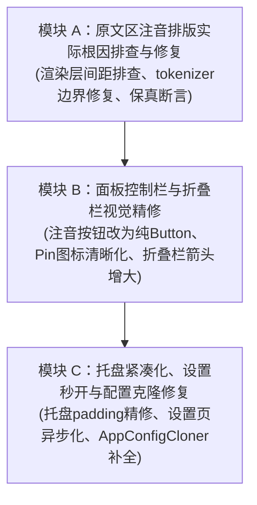

# Issue 031: 结果面板排版异常、Pin图标清晰度、折叠栏箭头与设置秒开深度治理

## 1. 缺陷背景与深入反思

在上一轮打磨中，虽然针对主人反馈的圆角和基本交互进行了调整，但数个核心交互与排版痛点仍未彻底解决，甚至暴露出底层更深层的问题。基于上下文反思与代码核实，根本原因剖析如下：

### 1.1 注音按钮风格未与常规按钮对齐
- **历史盲点**：将注音按钮作为 `ToggleButton` 并试图通过样式 patch 模拟普通 `Button`。但 Avalonia FluentTheme 对 `ToggleButton` 的内置模板在不同伪类（Checked / PointerOver / Pressed）下存在底色与阴影渗透，使得它在视觉和质感上始终无法与旁边的原生 `Button`（设置、规范化）达成像素级一致。
- **治理决策**：**直接将注音按钮改为原生 `Button` 控件**，共享完全相同的模板与样式类，消除任何控件类型层面的视觉差异；状态翻转交由内部逻辑管理。

### 1.2 Pin 按钮图标在部分系统上不清晰
- **历史盲点**：Pin 按钮使用了 `&#xE718;`（Segoe Fluent Icons / Segoe MDL2 Assets），FontSize 仅 12px，在某些 Windows 版本或主题下前景色可能与标题栏融合导致不够醒目。
- **已治理项（无需重复）**：面板失焦关闭逻辑已彻底切断（Deactivated 仅处理编辑态提交，注释明确"失焦绝不自动关闭"）；Pin 状态跨重启持久化已通过 `WindowConfig.ResultPanelPinned` + 原子写盘实现。
- **治理决策**：将 Pin 按钮图标改为高对比度矢量路径或可靠通用符号，增大尺寸，确保在任何系统与主题下肉眼清晰可见；Pinned 态草绿高亮，未置顶态常态可见。

### 1.3 原文区排版异常：视觉空隙与字符显示问题
- **历史盲点**：将问题简单归因于注音标注器的"游标漂移"，但经代码核实，`JapaneseFuriganaAnnotator` / `ChinesePinyinAnnotator` 的 `IndexOf` + cursor 追踪逻辑以及 `AnnotatedTextFormatter.Compose` 的索引拼接逻辑实际上是正确的，不存在系统性的游标漂移。
- **实际病灶分析**：排版异常的实际根因更可能在以下层面：
  1. **渲染层间距**：`RubyInlineControl` 的 Margin / Padding 或其在 `InlineUIContainer` 中的布局导致视觉空隙；
  2. **MeCab 分词边界**：MeCab 对混合文本（含英文、数字、标点）的 tokenization 在特定边界情况下可能产生异常 surface；
  3. **`RubyDocumentBuilder.BuildInlines()` 分行拼接逻辑**：按行切分后的拼接可能引入额外间隙。
- **治理决策**：
  1. 排查并修复原文区排版异常的**实际根因**，重点检查渲染层间距与 tokenizer 边界情况；
  2. 建立**绝对保真（Lossless Compose）断言**作为防御性保障：`ToPlainText(Compose(text, spans)) == text` 必须 100% 恒等，任何错位立即熔断回退，杜绝字符丢失与乱码；
  3. 内联排版引擎零间隙贴合。

### 1.4 精讲折叠栏灰黑背景残留与箭头偏小
- **历史盲点**：`Expander.clean` 已有完整自定义 ControlTemplate（Background=Transparent, BorderThickness=0, Chevron=13px ▶/▼），但灰黑背景仍可能存在。实际原因可能是父容器或宿主页面的背景设置、特定主题资源 key 的值不对，而非 Expander 自身模板。
- **治理决策**：排查 `Expander.clean` 灰黑背景的**实际来源**（重点检查父容器与主题资源）并修复；将左侧展开箭头从 13px 提升至 14px~16px，hover 保持和谐浅绿微光。

### 1.5 托盘菜单左右 Padding 过大
- **历史盲点**：重构居中模板时左右内边距设定为 `14px`，整体弹窗横向偏宽，不够收敛。
- **治理决策**：将 MenuItem 内边距精修收敛至 `8,6`，小巧紧凑、精致高级。

### 1.6 设置窗口打开仍然缓慢
- **历史盲点**：虽然对其他 4 个 Tab 进行了懒加载，但默认打开的 `GeneralPage` 构造函数与 `Load()` 中，均在 UI 主线程同步调用 `RefreshOcrDependencyCard()` + `RefreshPhoneticDictionaryCards()`，对多达 **15 个文件**进行 SHA256 哈希校验，造成主线程首屏显著卡顿。
- **治理决策**：将 `GeneralPage` 内部全部磁盘探测移至后台异步线程，或延迟到窗口 `Loaded` 首帧渲染完成后异步刷新，实现设置窗口毫秒级秒开。

### 1.7 AppConfigCloner 克隆遗漏导致配置静默重置
- **历史盲点**：`AppConfigCloner.Clone()` 在克隆 `GeneralConfig` 时**遗漏了 `AutoAnnotate` 和 `OcrListen` 字段**。后果是：用户打开设置窗口 → 不做任何修改关闭 → 窗口大小保存时写入的 config 会将这两个字段重置为代码默认值，静默覆盖用户实际配置。
- **治理决策**：在 `AppConfigCloner.Clone()` 中补全 `AutoAnnotate` 和 `OcrListen` 的克隆，确保所有 `GeneralConfig` 字段完整映射。

---

## 2. 任务拆分与实施规划

为了确保每个问题稳准狠根除，本次任务拆解为三个专项子模块：

### 模块 A：原文区注音排版实际根因排查与修复（重点攻坚）
1. **渲染层间距排查（`RubyDocumentBuilder.cs` / `RubyInlineControl.cs`）**：
   - 重点检查 `RubyInlineControl` 的 Margin / Padding 以及 `InlineUIContainer` 的布局属性；
   - 检查 `RubyDocumentBuilder.BuildInlines()` 分行拼接逻辑是否引入额外间隙；
   - 紧密无缝拼接，彻底消除视觉虚假空格。
2. **Tokenizer 边界情况（`JapaneseFuriganaAnnotator.cs` / `ChinesePinyinAnnotator.cs`）**：
   - 验证 MeCab 对混合文本（含英文、数字、平假名、片假名、标点、换行）的 tokenization 边界行为；
   - 严格限制底字区间只落于合法 CJK 汉字字符，严禁非汉字被并入 `AnnotationSpan`。
3. **保真断言（`AnnotatedTextFormatter.cs` / `RubyTextParser.cs`）**：
   - 建立单测断言：无论包含何种特殊字符，`ToPlainText(Compose(text, spans)) == text` 必须 100% 恒等；
   - 遇到任何异常区间即刻防御性跳过，宁缺毋滥，杜绝文字丢失与乱码。

### 模块 B：面板控制栏与折叠栏视觉精修
1. **注音按钮统一化（`ResultPanelWindow.axaml` / `.cs`）**：
   - 改为标准 `<Button>`，共享统一标准按钮样式；
   - 点击时切换内部布尔标志并触发刷新，视觉 100% 等同于"设置"和"规范化"。
2. **Pin 按钮图标清晰化（`ResultPanelWindow.axaml`）**：
   - 将 `&#xE718;` MDL2 字体图标替换为高对比度矢量路径或可靠通用符号，增大尺寸；
   - 确保在任何系统与主题下肉眼清晰可见，Pinned 态草绿高亮，未置顶态常态可见。
   - *(注：失焦关闭隔绝与跨重启持久化已完成，无需重复实现)*
3. **精讲折叠栏箭头增大与背景排查（`NaniKoreStyles.axaml`）**：
   - 排查灰黑背景的实际来源（`Expander.clean` 自身模板已透明，重点检查父容器与主题资源）；
   - 将左侧展开箭头从 13px 提升至 14px~16px。

### 模块 C：托盘紧凑化、设置秒开与配置克隆修复
1. **托盘右键菜单收敛（`NaniKoreStyles.axaml`）**：
   - `MenuItem` 的 Padding 精修调整为 `8,6`，紧凑秀丽。
2. **设置窗口首屏秒开（`GeneralPage.axaml.cs` / `SettingsWindow.axaml.cs`）**：
   - 将 `RefreshOcrDependencyCard` 与 `RefreshPhoneticDictionaryCards` 磁盘探测移入后台异步任务；
   - 窗口秒开立即可见，随后异步更新依赖就绪卡片。
3. **AppConfigCloner 克隆补全（`AppConfig.cs`）**：
   - 在 `AppConfigCloner.Clone()` 的 `GeneralConfig` 克隆中补充 `AutoAnnotate` 和 `OcrListen` 字段映射；
   - 确保打开设置窗口不会静默重置用户配置。

---

## 3. 验收标准与验证方案

1. **排版与字符保真验收**：
   - 框选包含汉字、平假名、片假名、英文、数字、符号、换行的复杂文本，原文区完整呈现，文字零丢失、零乱码；
   - 原文区字符紧密排布，无按词切断与多余空格。
2. **按钮与视觉验收**：
   - 注音按钮外观、高度、圆角与"设置"、"规范化"完全一致；
   - 右上角 Pin 按钮清晰可见，非置顶态失焦窗口不关闭，置顶态始终置顶，重启后状态保持；
   - 精讲折叠栏彻底无灰黑背景，绿色 hover 舒适自然，箭头清晰大方；
   - 托盘右键菜单紧凑居中。
3. **配置完整性验收**：
   - 打开设置窗口 → 不做修改关闭 → 验证 `AutoAnnotate` 和 `OcrListen` 配置值未被篡改。
4. **性能验收**：
   - 点击设置瞬间秒开弹窗，无卡顿感知。
5. **编译与自测跑测**：
   - `./scripts/dev.ps1 build` 0 警告 0 错误；
   - `--self-test` 包含上述全部场景且 100% 通过；
   - `./scripts/dev.ps1 build -Release` Native AOT 编译通过。
